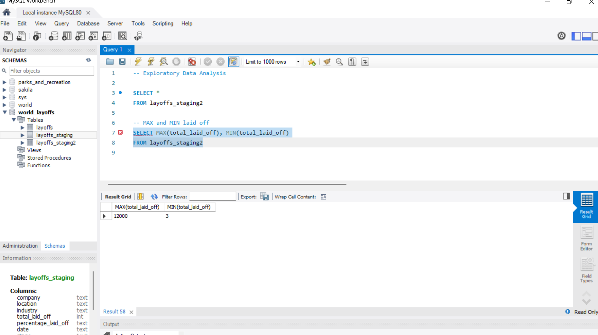
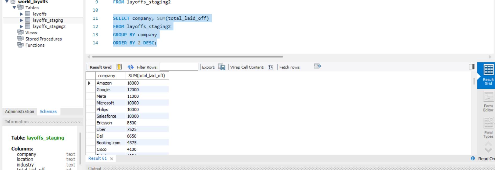
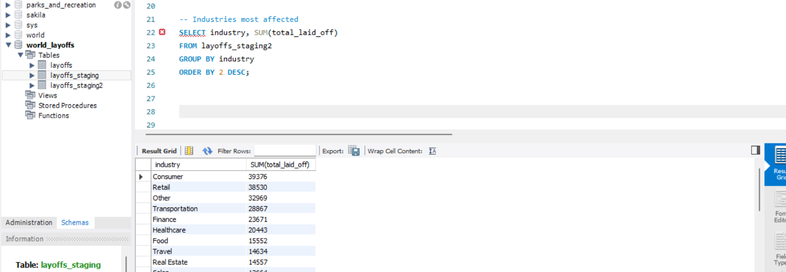
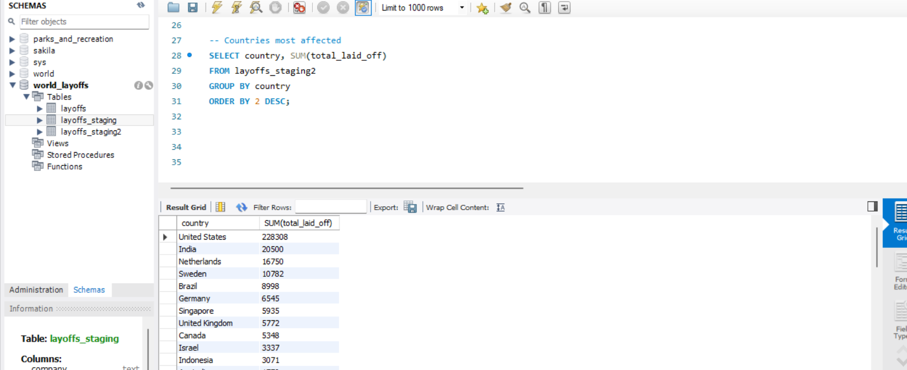
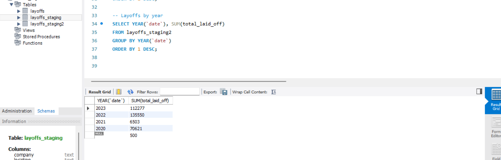
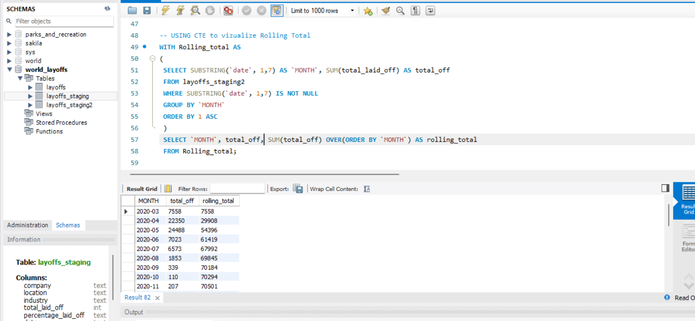
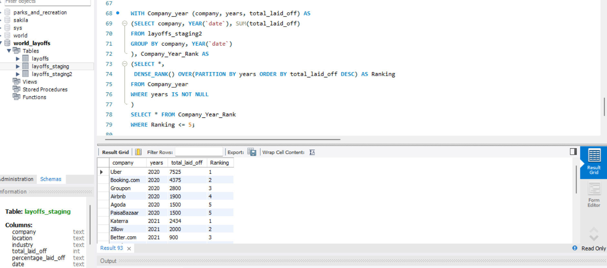

# Layoffs Exploratory Data Analysis (MySQL)

## Overview

Exploratory analysis of a global tech layoffs dataset, using the cleaned table produced in the [data cleaning project](../layoffs-sql-cleaning). The goal was to understand the scale, timing, and concentration of layoffs: which companies, industries, and countries were hit hardest, and how layoffs built up over time.

**Tools:** MySQL / MySQL Workbench
**Dataset:** [World Layoffs (Kaggle)](https://www.kaggle.com/datasets/swaptr/layoffs-2022)
**Input:** `layoffs_staging2`, the cleaned table from [part 1](../layoffs-sql-cleaning)
**Full script:** [`layoffs_eda.sql`](./layoffs_eda.sql)

## Questions and Techniques

| Question | SQL techniques |
|---|---|
| How large were the biggest and smallest layoff events? | `MAX`, `MIN` |
| What period does the data cover? | `MIN`, `MAX` on a `DATE` column |
| Which companies, industries, and countries lost the most jobs? | `GROUP BY`, `SUM`, `ORDER BY` |
| How did layoffs change year to year? | `YEAR()`, `GROUP BY` |
| How did layoffs accumulate month by month? | `SUBSTRING`, CTE, window `SUM() OVER` |
| Who were the top 5 companies in each year? | Multiple CTEs, `DENSE_RANK() OVER (PARTITION BY ...)` |

---

## 1. Size of the Largest and Smallest Layoff Events

```sql
SELECT MAX(total_laid_off), MIN(total_laid_off)
FROM layoffs_staging2;
```



The largest single layoff event was **12,000** people and the smallest was **3**, so event sizes vary enormously. That is a hint that company-level totals will be driven by a few very large events.

## 2. Time Span of the Data

```sql
SELECT MIN(`date`), MAX(`date`)
FROM layoffs_staging2;
```

This confirms the window the analysis covers. Because `date` was converted from text to a real `DATE` type during cleaning, `MIN` and `MAX` sort chronologically. On a text column they would sort alphabetically and return misleading results.

## 3. Total Layoffs by Company

```sql
SELECT company, SUM(total_laid_off)
FROM layoffs_staging2
GROUP BY company
ORDER BY 2 DESC;
```



Amazon leads with **18,000** layoffs, followed by Google (12,000), Meta (11,000), and Microsoft, Philips, and Salesforce (10,000 each).

## 4. Total Layoffs by Industry

```sql
SELECT industry, SUM(total_laid_off)
FROM layoffs_staging2
GROUP BY industry
ORDER BY 2 DESC;
```



Consumer (**39,376**) and Retail (**38,530**) were the most affected industries, followed by Other (32,969) and Transportation (28,867).

## 5. Total Layoffs by Country

```sql
SELECT country, SUM(total_laid_off)
FROM layoffs_staging2
GROUP BY country
ORDER BY 2 DESC;
```



The United States dominates with **228,308** layoffs, roughly 70% of all layoffs in the dataset. India is a distant second at 20,500, followed by the Netherlands (16,750) and Sweden (10,782).

## 6. Total Layoffs by Year

```sql
SELECT YEAR(`date`), SUM(total_laid_off)
FROM layoffs_staging2
WHERE YEAR(`date`) IS NOT NULL
GROUP BY YEAR(`date`)
ORDER BY 1 DESC;
```



| Year | Total laid off |
|---|---|
| 2023 | 112,277 |
| 2022 | 135,550 |
| 2021 | 6,503 |
| 2020 | 70,621 |

2022 was the peak year, and 2021 was unusually quiet. The screenshot above was taken **before** the `WHERE YEAR(date) IS NOT NULL` filter was added, which is why it shows a `NULL` row: 500 layoffs recorded without a date. The final query filters those out so they don't appear as a meaningless "year."

## 7. Monthly Layoffs and Rolling Total

First, layoffs per month. `SUBSTRING(date, 1, 7)` keeps the `YYYY-MM` part of the date:

```sql
SELECT SUBSTRING(`date`, 1, 7) AS `MONTH`, SUM(total_laid_off)
FROM layoffs_staging2
WHERE SUBSTRING(`date`, 1, 7) IS NOT NULL
GROUP BY `MONTH`
ORDER BY 1 ASC;
```

Then the same result wrapped in a CTE, with a window function adding a running total:

```sql
WITH Rolling_total AS
(
    SELECT SUBSTRING(`date`, 1, 7) AS `MONTH`, SUM(total_laid_off) AS total_off
    FROM layoffs_staging2
    WHERE SUBSTRING(`date`, 1, 7) IS NOT NULL
    GROUP BY `MONTH`
    ORDER BY 1 ASC
)
SELECT `MONTH`, total_off, SUM(total_off) OVER (ORDER BY `MONTH`) AS rolling_total
FROM Rolling_total;
```



The CTE does the monthly aggregation first, and the window function `SUM() OVER (ORDER BY MONTH)` then adds each month to everything before it. Layoffs spiked in **April 2020 (22,350)** and **May 2020 (24,488)**, which together account for most of the early-2020 total, then tapered off sharply, with the running total flattening at about 70,500 by November 2020.

## 8. Top 5 Companies per Year

```sql
WITH Company_year (company, years, total_laid_off) AS
(
    SELECT company, YEAR(`date`), SUM(total_laid_off)
    FROM layoffs_staging2
    GROUP BY company, YEAR(`date`)
),
Company_Year_Rank AS
(
    SELECT *,
        DENSE_RANK() OVER (PARTITION BY years ORDER BY total_laid_off DESC) AS Ranking
    FROM Company_year
    WHERE years IS NOT NULL
)
SELECT *
FROM Company_Year_Rank
WHERE Ranking <= 5;
```



The first CTE totals layoffs per company per year. The second ranks companies **within each year** (`PARTITION BY years`), and the final query keeps the top 5. In 2020 the top five were Uber (7,525), Booking.com (4,375), Groupon (2,800), Airbnb (1,900), and a tie at fifth between Agoda and PaisaBazaar (1,500 each).

`DENSE_RANK()` was chosen over `ROW_NUMBER()` so tied companies share a rank instead of one being arbitrarily dropped. That is why 2020 returns six rows for a "top 5."

---

## Key Takeaways

- **Layoffs were concentrated.** A handful of very large events (up to 12,000 people) drive the company totals, and the US accounts for about 70% of all layoffs in the data.
- **Consumer and Retail were hit hardest** among industries.
- **Timing was uneven.** Layoffs peaked in 2022, spiked sharply in April and May 2020, and were minimal in 2021.

## Notes and Limitations

- `SUM()` ignores `NULL` values, so totals reflect only layoffs where a headcount was reported. Rows missing `total_laid_off` do not add to any total.
- 500 layoffs have no recorded date, so they appear in company, industry, and country totals but not in the year and month breakdowns.
- The data covers publicly reported layoffs, not every layoff that occurred.

## SQL Skills Demonstrated

Aggregate functions (`SUM`, `MAX`, `MIN`), `GROUP BY` and `ORDER BY`, date functions (`YEAR`, `SUBSTRING`), CTEs (single and chained), and window functions (`SUM() OVER`, `DENSE_RANK() OVER (PARTITION BY ...)`).

---

⬅️ Previous: [Data Cleaning (Part 1)](../layoffs-sql-cleaning)
